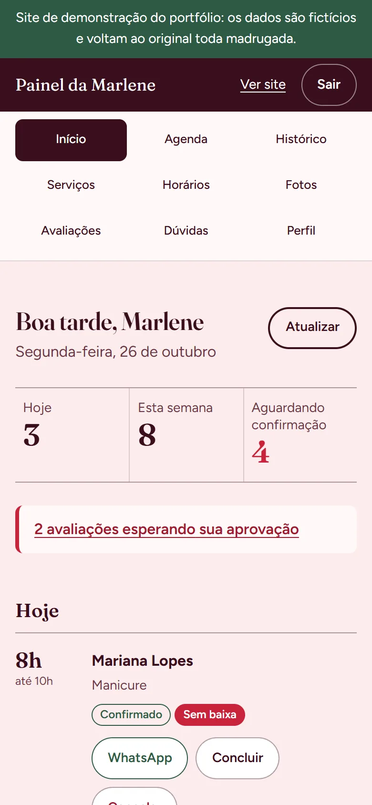
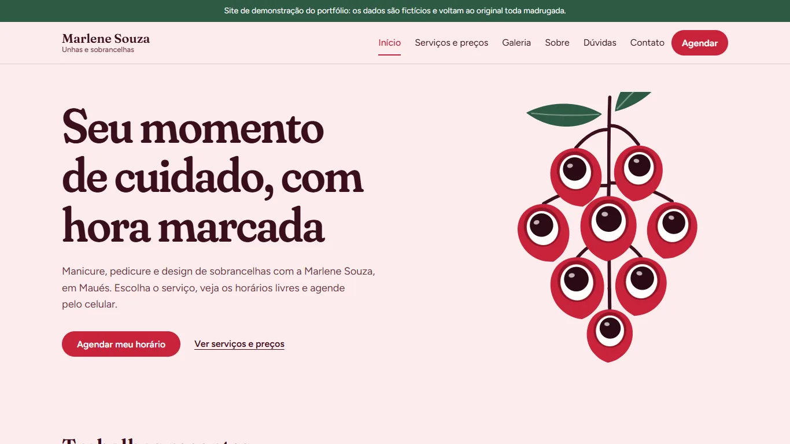
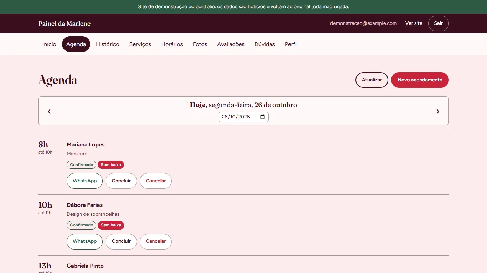

# Marlene Souza · agendamento de unhas e sobrancelhas

Sistema de agendamento on-line para uma profissional de unhas e sobrancelhas de Maués (AM).
As clientes escolhem o serviço, o dia e um horário livre pelo celular, e a profissional
administra a agenda, os serviços, as fotos e as avaliações num painel próprio.

O sistema está **em uso por uma cliente real**. Este repositório tem o código completo, e a
versão de demonstração abaixo roda com dados fictícios.

**[Abrir a demonstração](https://marlene-souza-demo.vercel.app)** · para entrar no painel, use
o acesso de demonstração que aparece na tela de login (`/admin/login`). Os dados voltam ao
original toda madrugada.

<p>
  
  
  
</p>



## O que o sistema faz

**Para as clientes** (quase sempre pelo celular)

- Agendamento em 4 passos: serviço, dia, horário livre e nome com WhatsApp. No fim, um botão
  avisa a profissional pelo WhatsApp com a mensagem já escrita.
- Só aparecem horários realmente livres: o sistema reserva o tempo máximo de cada serviço,
  respeita o expediente, o almoço, as folgas e a antecedência mínima.
- Serviços e preços, galeria de trabalhos, página "Sobre" com os certificados e cursos da
  profissional, contato com mapa e redes sociais, dúvidas frequentes e avaliações de outras
  clientes.
- Formulário para deixar uma avaliação, que só aparece no site depois de aprovada.

**Para a profissional** (painel com login)

- Início com os atendimentos do dia, os próximos e as avaliações esperando aprovação.
- Agenda por dia: confirmar, concluir, cancelar, chamar a cliente no WhatsApp e encaixar
  um atendimento marcado por fora.
- Histórico com filtro por período e por cliente.
- Cadastro de serviços (preço e duração), horários de funcionamento, almoço, folgas e
  feriados, fotos da galeria, certificados, dúvidas frequentes, avaliações e perfil (com
  Instagram, TikTok e Facebook).
- Fotos e certificados são reduzidos, convertidos para `.webp` e perdem a localização no
  próprio celular, antes do envio.



## Tecnologias

- **React 19** com **Vite 8** e **React Router 7**, em JavaScript
- **Supabase**: banco Postgres, login (Auth) e armazenamento das fotos (Storage)
- **CSS puro** com variáveis, sem framework, pensado primeiro para o celular
- **Vitest** para os testes e **oxlint** para a revisão automática do código
- **Vercel** para publicar o site

## Decisões técnicas

**A segurança fica no banco, não só na tela.** Todas as tabelas têm Row Level Security. O
público consegue ler serviços, fotos e avaliações aprovadas, criar agendamentos e enviar
avaliações, mas **não consegue ler os agendamentos**, que têm nome e telefone das clientes.
Para mostrar os horários livres, uma função no banco devolve só o início e o fim dos
horários ocupados.

**Dois agendamentos nunca ocupam o mesmo horário.** Uma *exclusion constraint* do Postgres
recusa qualquer horário que se sobreponha a outro, mesmo que duas clientes confirmem ao
mesmo tempo. O site trata esse erro com uma mensagem amigável. As regras da agenda
(expediente, almoço, folgas, antecedência) também são conferidas no banco antes de gravar.

**Uma demonstração que não estraga.** O portfólio usa um projeto Supabase separado, só com
dados fictícios e sem nenhum contato real. Nesse projeto, o banco impede enviar ou apagar
fotos e trocar a foto do perfil, e uma tarefa agendada (`pg_cron`) restaura tudo toda
madrugada. O mesmo código publica os dois sites, e uma variável de ambiente liga o modo
demonstração.

**Desempenho medido, não estimado.** Medições no site de demonstração, com o Chrome e o
Lighthouse no modo celular:

| | Antes | Depois |
|---|---|---|
| Código do painel baixado pelas clientes | casca do painel, login e CSS | nada |
| Arquivos de JavaScript que vão ao servidor na 2ª visita | 2 de 2 | 0 de 5 |
| Salto de layout (CLS) na galeria | 0,308 | 0,022 |
| Salto de layout (CLS) no agendamento | 0,119 | 0 |

O painel inteiro é carregado sob demanda, as bibliotecas (React, roteador e Supabase) ficam
em arquivos próprios com cache de um ano, e o espaço de cada foto é reservado antes de ela
carregar. A primeira visita continua em cerca de 150 kB de JavaScript comprimido.

**Acessibilidade.** Foco visível no teclado, contraste conferido, áreas de toque de 44 px,
respeito a "reduzir movimento" e dúvidas frequentes em `<details>`. O axe não encontrou
nenhum problema crítico ou sério nas 18 telas, no celular e no computador.

## Estrutura de pastas

```
src/
  config/        dados do negócio e modo demonstração
  lib/           Supabase, cálculo de horários livres, formatadores (com testes)
  hooks/         login, consultas e título da página
  components/    ui, layout, agendamento, painel e seções compartilhadas
  pages/         publico/ (clientes) e admin/ (painel, carregado sob demanda)
  styles/        variáveis (tokens.css) e CSS de cada área
supabase/
  migrations/    tabelas, funções, segurança (RLS) e Storage, em ordem
  seed.sql       dados fictícios da demonstração
  README.md      passo a passo para montar o banco
```

## Como rodar no seu computador

Você vai precisar do Node.js 22.12 ou mais novo e de um projeto gratuito no
[Supabase](https://supabase.com).

1. Monte o banco seguindo o [passo a passo do Supabase](supabase/README.md): migrations,
   usuário de login e, se quiser os dados de exemplo, o `seed.sql`.
2. Instale e configure:

   ```bash
   npm install
   cp .env.example .env.local   # preencha VITE_SUPABASE_URL e VITE_SUPABASE_ANON_KEY
   npm run dev
   ```

3. Outros comandos:

   ```bash
   npm test         # 84 testes (horários livres, formatadores, agenda, certificados...)
   npm run lint     # revisão automática do código
   npm run build    # versão de produção em dist/
   ```

A chave usada no site é a pública (`anon`/publishable). Quem protege os dados são as regras
do banco. A chave secreta (`service_role`) nunca vai para o site nem para o repositório.

## Como o projeto foi desenvolvido

Usei o [Claude Code](https://claude.com/claude-code) como assistente de programação durante
todo o projeto, para escrever e revisar código, SQL e documentação.

A minha parte foi o planejamento em fases, a revisão e aprovação de cada plano antes da
implementação, as conversas e decisões de negócio com a cliente (serviços, horários, regras de
agendamento, textos e fotos), a criação e a configuração dos projetos no Supabase e na Vercel,
os testes em cada etapa e a entrega para a cliente.

Com o projeto, aprendi na prática sobre banco de dados com regras de segurança (RLS),
autenticação, deploy contínuo e como transformar a necessidade de uma cliente real em um sistema.

## Autor

**Adriano Barbosa de Souza**

[GitHub](https://github.com/adrianosouza-dev)
